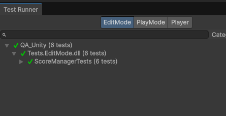
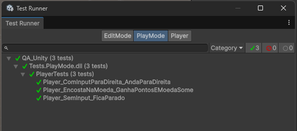
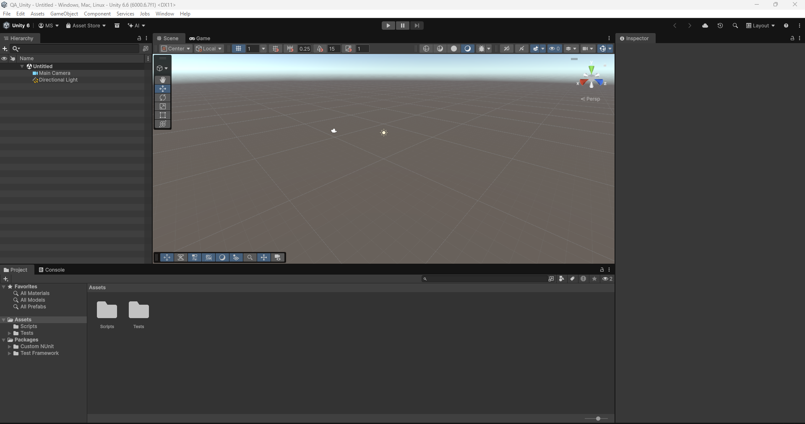

# Coin Collector — Unity Test Framework POC # Unity_Testing_PO_01

A tiny game used to show the basics of the **Unity Test Framework (UTF)**.
The **Player** moves with the arrow keys. When it touches a **Coin**, it scores points and the coin disappears.

## Project structure

```
Assets/
├── Scripts/                  (asmdef: Game.Runtime)
│   ├── ScoreManager.cs       score rules in plain C#
│   ├── Player.cs             movement + score
│   └── Coin.cs               trigger: adds points and destroys itself
└── Tests/
    ├── EditMode/             (asmdef: Tests.EditMode, Editor only)
    │   └── ScoreManagerTests.cs
    └── PlayMode/             (asmdef: Tests.PlayMode)
        └── PlayerTests.cs
Evidences/                    test run evidence
```

## What this POC covers

| # | Concept | Where |
|---|---|---|
| 1 | `com.unity.test-framework` package and the **Test Runner** window | `Packages/manifest.json` |
| 2 | **Assembly Definitions** separating game code from tests | `.asmdef` files |
| 3 | **EditMode** unit tests with `[Test]` (no game loop) | `ScoreManagerTests` |
| 4 | **NUnit** asserts: `Assert.AreEqual`, `Assert.Throws`, `Assert.That(..., Is.Zero)` | `ScoreManagerTests` |
| 5 | `[SetUp]` / `[TearDown]` to prepare and clean up each test | both test files |
| 6 | Data-driven tests with `[TestCase]` | `AddPoints_SomaNaPontuacao` |
| 7 | **PlayMode** tests with `[UnityTest]` + `IEnumerator` (`yield return null`, `WaitForSeconds`, `WaitForFixedUpdate`) | `PlayerTests` |
| 8 | Testing a **MonoBehaviour with physics** (trigger + `Destroy`) | `Player_EncostaNaMoeda_GanhaPontosEMoedaSome` |
| 9 | **Testable design**: logic in plain C#, controllable input on the Player | `ScoreManager`, `Player` |
| 10 | Running tests from the **command line** with an XML report | see below |

## Test cases

| Suite | Test | Checks |
|---|---|---|
| EditMode | `ComecaComZeroPontos` | Score starts at 0 |
| EditMode | `AddPoints_SomaNaPontuacao` (1, 10, 0) | Points are added to the score |
| EditMode | `AddPoints_Negativo_LancaExcecao` | Negative points throw an exception |
| EditMode | `Reset_ZeraAPontuacao` | Reset sets the score back to 0 |
| PlayMode | `Player_SemInput_FicaParado` | Player stays still with no input |
| PlayMode | `Player_ComInputParaDireita_AndaParaDireita` | Player moves right with right input |
| PlayMode | `Player_EncostaNaMoeda_GanhaPontosEMoedaSome` | Touching a coin adds points and destroys the coin |

## How to run

1. Install **Unity Hub** and **Unity 6** (tested with `6000.6.7f1`).
2. In Unity Hub: **Add → Add project from disk** and select this folder.
3. In the editor: **Window → General → Test Runner**.
4. Click **Run All** in the **EditMode** tab, then in the **PlayMode** tab.

### Command line

```powershell
& "C:\Program Files\Unity 6000.6.7f1\Editor\Unity.exe" -batchmode -projectPath . -runTests -testPlatform EditMode -testResults results-editmode.xml -logFile -
```

Use `-testPlatform PlayMode` for the PlayMode tests. The editor must be closed.

## Evidences

All tests passed in Unity `6000.6.7f1`.

| Suite | Passed | Failed |
|---|---|---|
| EditMode | 6 | 0 |
| PlayMode | 3 | 0 |

### EditMode results



### PlayMode results



### Project opened in Unity 6



### Test run (EditMode and PlayMode)

[▶ Watch the test run video](Evidences/b2.mp4)
